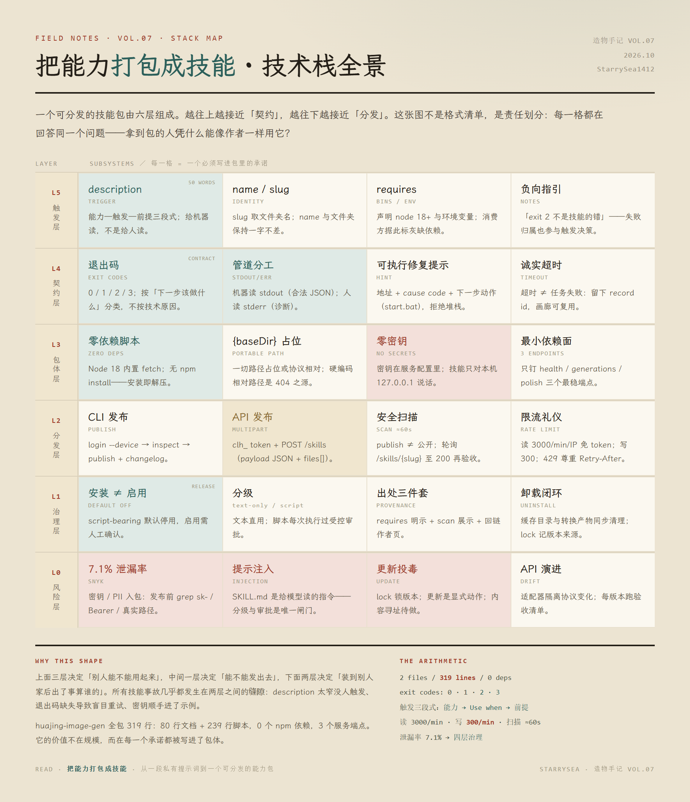

# 把能力打包成技能 · 造物手记 VOL.07

> 从一段写在自己系统提示里的流程，到任何人 `clawhub install` 就能用的两个文件。

**[打开这一页 →](https://starrysea1412.github.io/agent-skillcraft/)**



`huajing-image-gen`（[ClawHub 页面](https://clawhub.ai/starrysea1412/skills/huajing-image-gen)）把本机画境生图服务打包成技能：**80 行 SKILL.md + 239 行零依赖脚本，共 319 行、0 个 npm 依赖、只依赖 3 个服务端点**。这篇拆这次打包的全过程——frontmatter 怎么写、退出码怎么定、description 为什么是最贵的五十个词、发布流水线的 slug 陷阱与 ≈60 秒扫描、装到别人家之后的分级治理，以及 Snyk 那个 7.1% 的泄漏率意味着什么。

## 七章

| # | 章节 | 讲什么 |
|---|---|---|
| 01 | 提示词不是能力 | 分发、契约、审计、触发——私藏流程与可安装技能的四行对照表 |
| 02 | 解剖一个 SKILL.md | 六个部件各对应一种失败：slug 同一性、description 三段式、requires、{baseDir}、退出码、Notes |
| 03 | 最贵的五十个词 | description 逐短语拆解；写宽与写窄；「能力—触发—前提」三段式与触发测试集 |
| 04 | 零依赖脚本 | 239 行 / 4 个退出码 / JSON 走 stdout；可执行修复提示；超时 ≠ 任务失败 |
| 05 | 发布流水线 | slug = 文件夹名；≈60s 安全扫描是异步的；读 3000/min 免 token 的合规礼仪；五条验收清单 |
| 06 | 装到别人家 | 安装 ≠ 启用；text-only / script-bearing 分级；转换的有损边界；市场页三条信息义务 |
| 07 | 供应链与治理 | 7.1% 泄漏率逐字读；四类风险四种漏点；只钉三个最稳端点；四层治理是卖点不是负担 |

## 四枚可玩小样

全部是**确定性模型**，不是录屏：

- **SKILL.md 解剖台**：六个部件任意开关，五项检查（可触发/可执行/可恢复/可迁移/可安装）实时亮红——每个部件对应一种确定的失败。
- **触发实验台**：输入用户原话，六条技能按语义重合度竞争；切换泛化描述开关，看误触发怎么发生。
- **安装验收流水线**：六步状态机，注入 slug 不一致 / 扫描未过 / 服务未启动 / 未审批四种故障，看它停在哪、提示写什么。
- **供应链体检**：十份样本 × 四道策略开关；关掉「拦截密钥」，#07 与 #09 立即漏网——7.1% 就是这么来的。

## 技术实现

- `index.html` 单文件承载：零构建、零依赖、原生 JS
- kraft 快递工坊主题（`--kraft #ece4d2` / 深青 `#2b5f5a` / 牛血红 `#a03b2a` / 黄铜 `#8a6a2f`），标签虚线与硬阴影
- 自托管 LXGW 文楷子集（1036 字形 × 2 字重，各约 200KB）
- 五张插图由 GPT 系图像模型生成
- 验收：本地静态服务 + Playwright 无头逐状态截图（`build/verify.mjs`）、逐屏滚动截图（`build/scroll.mjs`），0 pageerror、0 broken image、移动端 0 横向溢出

## 构建

```bash
node build/build.mjs        # build/*.html + style.css + demos.js → index.html
node build/verify.mjs       # 四枚小样逐状态截图 + 错误收集 → shots/
node build/scroll.mjs       # 逐屏截图 → shots/scroll/
node build/render-stack.mjs # docs/tech-stack.html → assets/tech-stack.png
```

## 事实出处

- 技能包本体：`ai-image-studio/clawhub-skill/huajing-image-gen/`（SKILL.md 80 行 / scripts/huajing.mjs 239 行）
- 发布实录：ClawHub v1.0.0（starrysea1412），slug=文件夹名、≈60s 扫描、install 闭环验证
- API 边界与限流、7.1% 泄漏率、消费方分级治理：`AI-skill/docs/clawhub-integration-plan.md`
